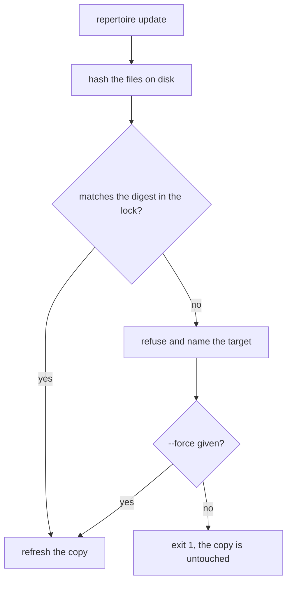

# The skill lockfile

Copying a `SKILL.md` folder into an agent directory works once. It does not tell
you what you installed, where it came from, or whether the copy on this machine
is still the copy that was approved. A lockfile is the file that answers those
three questions, and it is the part of Repertoire that a copier does not have.

## What is recorded

`repertoire add` writes one entry per skill into a lock file, next to the
manifest. The entry holds:

| Field | What it is |
| --- | --- |
| `catalog` | The name the catalog was registered under |
| `source` | The catalog's Git URL or local path |
| `commit` | The catalog commit the skill came from, empty for a loose local directory |
| `digest` | The content digest of the skill as published |
| `target_digests` | One digest per target directory the skill was installed into |
| `targets` | The target names, for example `claude`, `codex` |
| `locations` | The absolute path of every installed copy |
| `origin` | `declared` when the manifest asked for it |

A shortened entry, from a project that installed two targets:

```json
{
  "schema": 1,
  "skills": {
    "demo": {
      "catalog": "catalog",
      "source": "/home/me/skills/catalog",
      "commit": "",
      "digest": "9adc7193d0142804d23edca8240ab16c…",
      "target_digests": {
        "claude": "9adc7193d0142804d23edca8240ab16c…",
        "codex": "9adc7193d0142804d23edca8240ab16c…"
      },
      "targets": ["claude", "codex"],
      "locations": [
        "/home/me/project/.claude/skills/demo",
        "/home/me/project/.codex/skills/demo"
      ],
      "origin": "declared",
      "declared": true
    }
  }
}
```

Paths shortened and hashes truncated for readability. Commit the file. It is the
record of what the team agreed to run.

## What the digest covers

The digest is a SHA-256 over the skill directory, computed the same way on every
platform:

1. Walk the skill directory and collect every path below it.
2. Skip `REPERTOIRE.digest.asc`, the detached signature file, so a signature does
   not change the hash of the thing it signs.
3. Sort the paths.
4. For each path write the relative path, a NUL, the file mode string, and
   another NUL. For a symlink, then write its target. For a regular file, then
   write its bytes. Directories contribute their path and mode only.
5. Hash the whole stream.

So a renamed file, a changed permission bit, a swapped symlink and an edited
line all produce a different digest. The signature file is the one exception,
and it is the only one.

## Why the digest is per target

Two agents hold two copies, and one of them may have been edited. A single
digest would have to pick which copy it means. Instead the lock keeps one digest
per target, and `show` reports each copy separately:

```text
$ repertoire show demo --project
name	demo
catalog	catalog
digest	9adc7193d0142804d23edca8240ab16ce5fa00d183063fce5b4fd8e97664dd8e
origin	declared
target	claude	/home/me/project/.claude/skills/demo	modified
target	codex	/home/me/project/.codex/skills/demo	intact
```

The same skill is intact in Codex and modified in Claude. That distinction is
what a single lock cannot express and what a folder of copies cannot tell you at
all.

## What an update does

Two outcomes, and the second one is the point.



**Updated.** Nothing was edited, so the copy is refreshed:

```text
$ repertoire update
updated demo
```

**Refused.** A copy no longer matches its recorded digest, so Repertoire stops
and names the target:

```text
$ repertoire update
error: install "demo" to claude: target is unmanaged or locally modified; use --force to replace it
$ echo $?
1
```

The exit code is 1, so a CI job fails rather than shipping a local edit. Pass
`--force` when replacing the copy is what you mean:

```text
$ repertoire update --force
updated demo
```

`--force` overwrites the copy. The edit is gone, which is what force means.

## Where the files live

| Scope | Manifest | Lock |
| --- | --- | --- |
| `--project` | `<git root>/repertoire.yaml` | `<git root>/repertoire.lock.json` |
| default | `<user config dir>/repertoire/repertoire.yaml` | `<user config dir>/repertoire/repertoire.lock.json` |

`--project` requires a Git worktree and refuses to run outside one. The user
config directory is `~/Library/Application Support` on macOS and `~/.config` on
Linux. The project lock is the one to commit; it is what a teammate and a CI job
read.

## What it does not prove

A digest detects change. It does not establish who published the change. That
needs a signature, and signatures are opt-in per catalog: a catalog can require
signed commits, and a trusted skill can ship `REPERTOIRE.digest.asc`, a detached
signature over its content digest. Verification runs locally in a temporary
keyring, imports only the keys named in the trust block, and never contacts a
keyserver. Without a trust block, the digest still catches drift, and the lock
still refuses to overwrite your edit.

What none of it does is tell you whether the instructions are safe. A skill is
text an agent will follow with your credentials. The lock answers "is this the
version we approved", not "is this version good".

See [Targets and security](targets-security.md) for the trust block and the
verification rules.

## Reproduce it

```bash
# install into two targets and write the lock
repertoire add zensical --target claude --target codex --project

# what the lock recorded, per target
repertoire show zensical --project

# edit one copy, then watch the update refuse
echo "local note" >> .claude/skills/zensical/SKILL.md
repertoire update --project

# replace it anyway
repertoire update --force --project
```
